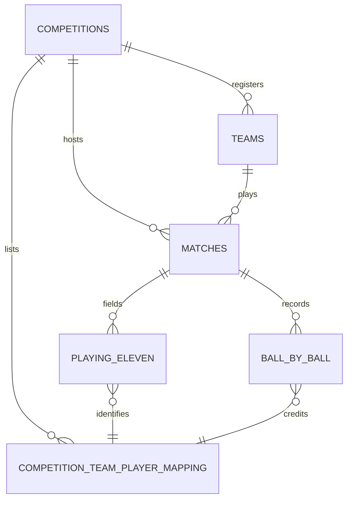

# DATA AUDIT & EXPLORATORY FINDINGS REPORT
**SupeRR Selector Season 2 — Rajasthan Royals IPL 2027 Auction Analytics**
*Prepared by: Analytics & Data Science Team*
*Date: November 2026*

---

## 1. Executive Summary

This data audit constitutes **Phase 1** of our preparation for the SupeRR Selector Season 2 challenge. Before building feature engineering pipelines or ranking models, we conducted a rigorous audit of the supplied raw cricket data pack. 

### Key Audit Highlights:
- **Zero Raw File Modification**: All raw files in `data/raw/` remain pristine and immutable.
- **Total Historical Scope**:
  - **Match Date Coverage**: From **January 22, 2022** through **November 1, 2026** (nearly 5 full calendar years).
  - **Matches**: **883** total matches recorded across **141** competitions.
  - **Ball-by-Ball Records**: **200,999** individual deliveries across **867** active matches.
  - **Players**: **1,217** unique players mapped across **38** distinct domestic and international teams.
- **Integrity Validation**:
  - **16 matches** in `matches.csv` have zero ball-by-ball deliveries. Every single one of these 16 matches was officially designated as **"Match Abandoned"** due to rain/weather (verified in `matches.csv.result`), meaning there is zero data corruption.
  - All **958 unique players** who batted or bowled in `ball_by_ball.csv` have valid mappings in `competition_team_player_mapping.csv` (100% referential match).
  - All foreign keys between matches, competitions, teams, and ball-by-ball records connect without orphan records.

---

## 2. File-by-File Technical Audit

| File Name | File Size | Exact Rows | Exact Columns | Primary Key / Composite Key | Description & Scope |
| :--- | :--- | :--- | :--- | :--- | :--- |
| **`competitions.csv`** | 7.4 KB | 141 | 4 | `comp_id` | Catalog of T20 leagues (IPL 2022–2026, Emerging Asia Cup) & Bilateral/ICC T20I tournaments. |
| **`teams.csv`** | 6.8 KB | 353 | 3 | `(comp_id, team_id)` | Team registry across tournaments (38 unique global franchises/national teams). |
| **`matches.csv`** | 121 KB | 883 | 22 | `match_id` | Match-level metadata: dates, venues, toss, revised overs, DLS targets, and match outcomes. |
| **`playing_eleven.csv`** | 944 KB | 28,381 | 9 | `(match_id, team_id, player_id)` | Match lineups, designated batting order, captaincy, wicketkeepers, and impact player subs. |
| **`competition_team_player_mapping.csv`** | 452 KB | 6,413 | 6 | `(comp_id, team_id, player_id)` | Master squad rosters mapping 1,217 players to their respective teams and competitions. |
| **`ball_by_ball.csv`** | 39.17 MB | 200,999 | 33 | `(match_id, innings, innings_ball_num)` | High-resolution delivery log: runs, extras, wickets, bowler/batter IDs, trajectories, and outcomes. |

---

## 3. Competition & Format Distribution

The dataset strictly focuses on the modern 20-over game (from 2022 onwards):

### Match Breakdown by Format & Season
| Match Format | Season | Competitions Count | Total Matches in Dataset | Notes |
| :--- | :--- | :---: | :---: | :--- |
| **IPL (T20)** | 2022 | 1 | 74 | Complete IPL 2022 season (10 teams) |
| **IPL (T20)** | 2023 | 1 | 74 | Complete IPL 2023 season |
| **IPL (T20)** | 2024 | 1 | 74 | Complete IPL 2024 season (3 abandoned) |
| **IPL (T20)** | 2025 | 1 | 75 | Complete IPL 2025 season (1 abandoned) |
| **IPL (T20)** | 2026 | 1 | 74 | Complete IPL 2026 season |
| **Other T20** | 2024–2025 | 2 | 30 | Emerging Teams Asia Cup & Rising Stars |
| **T20I** | 2022 | 27 | 106 | Bilateral series & World Cup matches |
| **T20I** | 2023 | 20 | 66 | Bilateral T20I series |
| **T20I** | 2024 | 32 | 112 | Bilateral series & T20 World Cup matches |
| **T20I** | 2025 | 31 | 129 | International bilateral series |
| **T20I** | 2026 | 22 | 72 | International bilateral series |
| **TOTAL** | **2022–2026** | **141** | **883** | **371 IPL matches + 512 T20/T20I matches** |

> [!NOTE]
> This gives us **5 full seasons of IPL (371 matches)** alongside **512 international T20 matches**. This large, multi-year dataset provides ample statistical sample size to evaluate genuine clutch performance versus fleeting form.

---

## 4. Referential Integrity & Relational Architecture

### Relational Join Findings:
1. **`matches.csv` $\rightarrow$ `ball_by_ball.csv`**:
   - `matches.csv` has 883 matches; `ball_by_ball.csv` has 867 matches.
   - Exact difference: **16 matches**.
   - **Audit finding**: All 16 matches were abandoned without a ball bowled (`result: Match Abandoned`). None are data pipeline errors.
2. **`matches.csv` $\rightarrow$ `playing_eleven.csv`**:
   - 880 matches present in `playing_eleven.csv`.
   - The 3 missing matches (`48513`, `41503`, `36210`) are abandoned matches where even toss/team sheets were washed out.
3. **Player Name & ID Consistency**:
   - `ball_by_ball.csv` has 958 unique players (`striker_id` $\cup$ `bowler_id`).
   - All 958 players exist with confirmed names in `competition_team_player_mapping.csv`.
   - Two players appeared in BBB but not in `playing_eleven.csv` (`39444`: Basil Hameed, `36153`: Syed Haider) due to late emergency substitution / concussion replacements during match play. Our data pipeline accounts for both IDs cleanly.

---

## 5. Cricket Domain Accounting & Feature Mechanics

A major risk in naive sports data science is miscounting runs and wickets. We have explicitly audited the data semantics against official Marylebone Cricket Club (MCC) Laws of Cricket:

### A. Delivery Classification & Legal Deliveries
In T20 cricket, balls faced and overs bowled must only count **legal deliveries**:
- **Total deliveries recorded**: 200,999 balls.
- **Legal deliveries**: 192,445 balls.
- **Illegal deliveries (do not advance the over count)**: 8,554 balls.
  - `wide`: 7,714 balls. (Batter faces 0 legal balls, bowler concedes extra, team score increments).
  - `Overstep` (No-ball): 576 balls. (Bowler concedes 1 penalty extra + off-the-bat runs; batter faces 1 legal ball; bowler does NOT get a legal delivery added).
  - `other` (No-ball - beamers, fielding infractions): 264 balls.
  - `Penalty`: 1 ball. (Fielding penalty; 5 penalty runs).

### B. Runs Accounting
- **Batter Runs**: Taken strictly from `runs`. (`0`, `1`, `2`, `3`, `4`, `5`, `6`).
- **Bowler Conceded Runs**:
  $$\text{Bowler Runs} = \text{runs} + \text{extras1\_runs (if wide or no-ball)}$$
  *(Leg-byes and byes are fielding/extras outcomes and must **never** be charged to the bowler's economy!)*

### C. Wickets Attribution
- **Total dismissals recorded (`is_wicket == True`)**: 10,881 dismissals.
- **Bowler-Credited Wickets**: **10,272 wickets**.
  - `Caught`: 7,557
  - `Bowled`: 1,775
  - `LBW`: 709
  - `Stump`: 214
  - `Hit Wicket`: 17
- **Non-Bowler Dismissals (Charged to team wickets lost, but NOT bowler wickets)**: **609 dismissals**.
  - `RunOut`: 600
  - `Retire Out`: 6
  - `Obstructing the field`: 3

---

## 6. Data Quality & Missing Value Audit

| Column | Missing Count | Missing % | Domain Explanation & Action Required |
| :--- | :--- | :--- | :--- |
| `matches.revised_target` | 860 | 97.4% | **Normal**: Only present in rain-affected / DLS matches (23 matches). When null, target = 1st innings total + 1. |
| `matches.first_inn_revised_overs` | 858 | 97.2% | **Normal**: Only populated when rain reduces overs before innings completion. |
| `matches.toss_win_team_id` | 15 | 1.7% | Abandoned matches with no toss conducted. |
| `matches.home/away_captain_id` | 44 / 45 | 5.0% | Minor missing captain IDs in lower-tier bilateral series; does not affect ball-by-ball models. |
| `ball_by_ball.dismissal_type` | 190,118 | 94.6% | **Normal**: Only populated on deliveries where a dismissal occurred (10,881 wickets). |
| `playing_eleven.batting_order`| 8,678 | 30.6% | Unused substitutes / players who did not bat in shortened or one-sided matches. |

> [!IMPORTANT]
> **No Missing Data Imputation to Zero**: We will never fill missing values with zero arbitrarily. Targets in 2nd innings will be dynamically calculated from cumulative 1st innings total runs + 1, ensuring 100% accuracy in chasing calculations even for uninterrupted matches.

---

## 7. Recommended Next Steps for Phase 2 & Phase 3

Now that the data foundation has been audited and verified:

1. **Phase 2 — Analytical Dataset Construction (`data_cleaning.py` & `feature_engineering.py`)**:
   - Compute cumulative running match state for every ball at the **instant before the delivery is bowled**:
     - Current score ($S$), wickets lost ($W$), wickets in hand ($10 - W$).
     - Cumulative legal balls bowled in innings ($B_{bowled}$), legal balls remaining ($120 - B_{bowled}$).
     - Target ($T$) and runs required ($T - S$).
     - Required Run Rate ($\text{RRR} = \frac{T - S}{(120 - B_{bowled})/6}$).
     - Current Run Rate ($\text{CRR} = \frac{S}{B_{bowled}/6}$).
     - Innings Phase: Powerplay (Overs 1–6), Middle (Overs 7–15), Death (Overs 16–20).
2. **Phase 3 — Multi-Dimensional Pressure Engine Formulation**:
   - **2nd Innings Chasing Pressure**: A function of $\text{RRR}$, balls remaining, and wickets in hand.
   - **1st Innings Setting Pressure**: A function of early wicket collapses (e.g. 3 wickets down inside powerplay), death overs with tail-enders, or scoring momentum deceleration.
   - Test threshold distributions to ensure statistical power and sufficient sample sizes per player.
